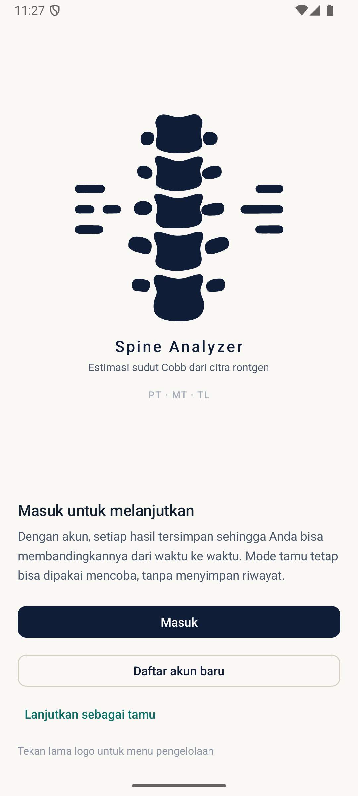
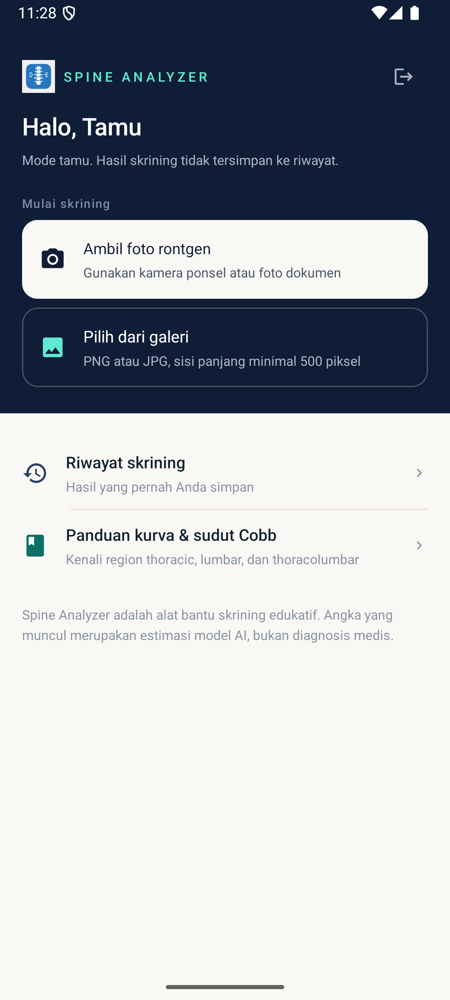
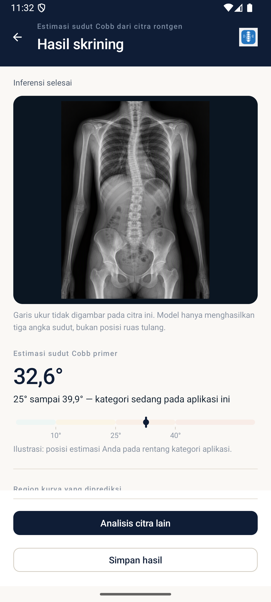
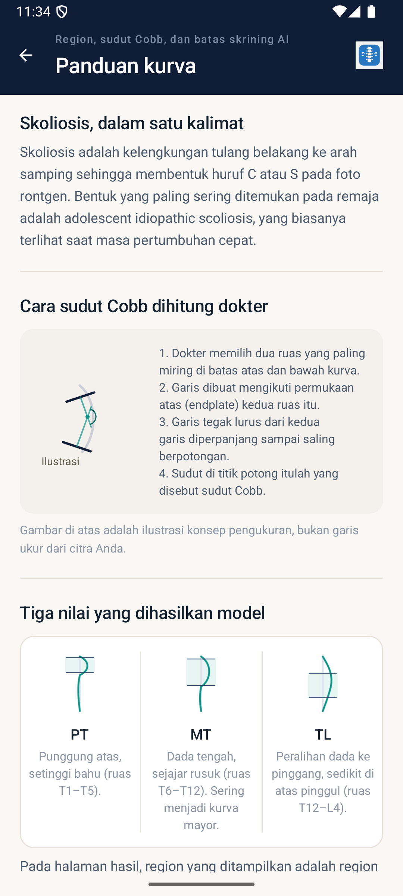

# Spine Analyzer

**Spine Analyzer** adalah aplikasi Android untuk membantu mengestimasi sudut Cobb pada citra rontgen tulang belakang menggunakan model kecerdasan buatan. Aplikasi dapat diunduh dan dicoba melalui APK yang tersedia di [GitHub Releases](https://github.com/Valearaafi/Spine-Analyzer/releases).

---

## Latar Belakang & Tujuan

Skoliosis umumnya dievaluasi menggunakan **sudut Cobb**, yaitu ukuran kelengkungan tulang belakang yang diperoleh dari citra rontgen. Pengukuran sudut Cobb biasanya dilakukan secara manual oleh tenaga medis dan membutuhkan ketelitian serta waktu.

Spine Analyzer dikembangkan sebagai alat bantu untuk memberikan **estimasi cepat** sudut Cobb dari sebuah citra rontgen dengan memanfaatkan model pembelajaran mesin yang berjalan sepenuhnya di perangkat (on-device). Tujuannya adalah membantu proses skrining awal dan pembelajaran, **bukan** menggantikan pemeriksaan oleh dokter.

## Fitur yang Tersedia

- **Estimasi sudut Cobb** dari citra rontgen yang dipilih dari galeri perangkat.
- Hasil estimasi untuk tiga segmen tulang belakang: **Proksimal Torakal (PT)**, **Torakal Utama (MT)**, dan **Torakolumbal (TL)**.
- **Halaman hasil** yang menampilkan estimasi dalam bentuk angka dan skala visual, beserta panduan interpretasi kontekstual.
- **Riwayat analisis** yang tersimpan secara lokal di perangkat.
- **Akun pengguna**: daftar dan masuk untuk menyimpan riwayat secara teratur, atau lanjut sebagai **tamu**.
- **Panduan skoliosis** berisi penjelasan singkat tentang jenis kurva dan batasan interpretasi.
- **Area administrasi** untuk mengelola data pengguna, analisis, dan aturan interpretasi.
- Seluruh pemrosesan gambar dan inferensi model berjalan **langsung di perangkat** (offline, tanpa mengunggah gambar).

## Tangkapan Layar

| Layar Sambutan | Beranda |
| --- | --- |
|  |  |

| Hasil Skrining | Panduan Kurva |
| --- | --- |
|  |  |

## Teknologi yang Digunakan

- **Android native (Java)** — antarmuka dan logika aplikasi.
- **TensorFlow Lite** — inferensi model estimasi sudut Cobb di perangkat (MobileNetV2 + regressor).
- **SQLite** — penyimpanan data pengguna, riwayat analisis, dan aturan interpretasi secara lokal.
- **Gradle** — sistem build.

Spesifikasi aplikasi: Android 7.0 (API 24) ke atas, mendukung perangkat ARM (`armeabi-v7a` dan `arm64-v8a`).

## Mengunduh & Memasang

1. Buka halaman [Releases](https://github.com/Valearaafi/Spine-Analyzer/releases) di repositori ini.
2. Unduh APK pada rilis terbaru (misalnya `SpineAnalyzer-debug.apk`).
3. Pada ponsel Android, buka berkas APK yang sudah diunduh.
4. Jika diminta, izinkan pemasangan dari sumber tidak dikenal (*Settings → Install unknown apps*).
5. Ikuti proses pemasangan hingga selesai, lalu buka aplikasi.

> **Catatan**: APK yang tersedia ditandatangani dengan kunci *debug* untuk keperluan uji coba. Jika sebelumnya pernah memasang versi lama Spine Analyzer dengan tanda tangan berbeda, hapus terlebih dahulu versi lama sebelum memasang APK ini.

## Keterbatasan & Peringatan

- Hasil yang ditampilkan adalah **estimasi berbasis kecerdasan buatan**, **bukan diagnosis medis**.
- Aplikasi ini **tidak** menggantikan konsultasi, pemeriksaan, atau pengukuran oleh dokter atau tenaga medis profesional.
- Estimasi dapat dipengaruhi oleh kualitas citra, posisi pengambilan gambar, dan kondisi rontgen.
- Pengujian sejauh ini dilakukan pada **emulator Android**; aplikasi belum melalui uji klinis atau validasi medis apa pun.
- Jika Anda memiliki kekhawatiran tentang kesehatan tulang belakang, segera konsultasikan dengan dokter.

## Privasi

Semua data (akun, riwayat analisis, dan pengaturan) disimpan **secara lokal** di perangkat Anda. Citra yang dianalisis tidak diunggah ke server mana pun.

## Versi

- **Versi aplikasi**: 1.0
- **Tanggal rilis**: 31 Oktober 2026

---

Kode sumber aplikasi tidak dipublikasikan di repositori ini. Repositori ini khusus untuk distribusi (dokumentasi dan APK).
